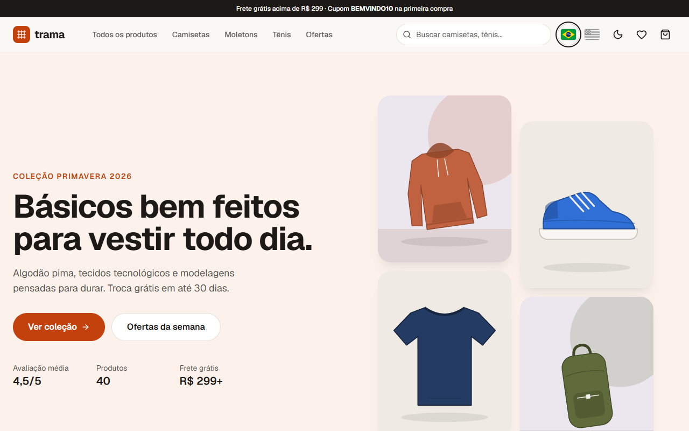

# Trama | Next.js e-commerce

[Português](README.md) · **English**

A casual fashion store built with **Next.js 16 (App Router)**, **React 19** and **TypeScript**, published as a 100% static site on Cloudflare. It covers a complete storefront flow: a home page rendered at build time, a catalog with URL-synced filters, statically generated product pages with SEO and Open Graph, a persisted cart, shipping quotes by CEP (Brazilian zip code), a discount code, a multi-step checkout validated with Zod + React Hook Form, address lookup on ViaCEP and an order confirmation with simulated card, Pix or boleto payment. The UI and the catalog are available in **Portuguese and English**.

**Demo:** https://portfolio.brunoisaac.dev/next-ecommerce-store/ (redirects to `/pt-BR/` or `/en/` based on your browser language)



> Portfolio project: no payment is processed and no data leaves your browser.
> To try the checkout use CPF `529.982.247-25`, card `4111 1111 1111 1111`, any future expiry date, CVV `123` and the code `BEMVINDO10`.

## Highlights

- **Home** as Server Components; **catalog** with accent-insensitive search, filters (category, price, color, size, rating, sale) and sorting, all stored in the URL.
- **40 product pages** via `generateStaticParams`, with a gallery, a color picker that re-tints the generated SVG artwork, size validation, wishlist and related products.
- **SEO:** per-product `generateMetadata`, canonical and `hreflang`, Open Graph PNG images generated at build time, `Product` JSON-LD, static `sitemap.xml` and `robots.txt`.
- **Cart** drawer and page with free-shipping progress, regional shipping table by CEP and the `BEMVINDO10` coupon; persisted in `localStorage` and synced across tabs.
- **Checkout** in 3 steps (details, delivery with ViaCEP autofill, payment with card/Pix/boleto) validated by Zod schemas built from tested validators (CPF check digits, Luhn, expiry).
- **Accessible and responsive:** semantic HTML, labelled fields and errors, native `<dialog>` drawers, visible focus, reduced motion support and a dark theme without flashes.

## Internationalization

- `app/[locale]` generates one static tree per language (`/pt-BR/...`, `/en/...`), and its layout owns `<html lang>`.
- `/` picks the language in the browser (saved choice > browser language > pt-BR) and redirects, since a static host cannot read `Accept-Language`.
- The header shows **flag links** (inline SVG, `<a hreflang>`, accessible names in their own language, `aria-current` on the active one); the choice is saved and the query string is kept.
- Typed dictionaries (`src/i18n/dictionaries`): `pt-BR.ts` defines the `Dictionary` type, `en.ts` must match it. Server Components read them directly; Client Components use `useI18n()`.
- Product names, descriptions, categories, colors and sizes are translated. Dates and numbers follow the locale, and prices are always in **BRL**.
- To add a language: extend `src/i18n/config.ts`, add a dictionary and the catalog copy, add a flag, and run the tests (they compare every dictionary's shape).

## Stack

Next.js 16.3.5 (`output: "export"`), React 19.2.8, TypeScript 5.9 (strict), Tailwind CSS 4.3.3, Zustand 5.0.15, React Hook Form 7.88, Zod 4.6, Vitest 5.0 + Testing Library, ESLint 9, Prettier 3, GitHub Actions + Cloudflare Workers static assets.

## Running locally

Requires Node.js 22 and npm 10.

```bash
npm install
npm run dev          # http://localhost:3000/next-ecommerce-store
npm run lint
npm run typecheck
npm test
npm run build        # static export in ./out
npm run build:cf     # same production build used by the Cloudflare deploy
npm start            # serves ./out under the base path
```

## Deploy

Published on Cloudflare (Workers static assets) at https://portfolio.brunoisaac.dev/next-ecommerce-store/ by the pipeline of the [portfolio](https://github.com/BrunoICosta/portfolio) repository (`npm run build:cf`, output in `out/`).

See the [Portuguese README](README.md) for the full architecture notes, how this would work with SSR on Vercel, the folder structure and next steps.

## Author

**Bruno Vinicius Isaac Costa** · https://github.com/BrunoICosta

[MIT](LICENSE) license.
