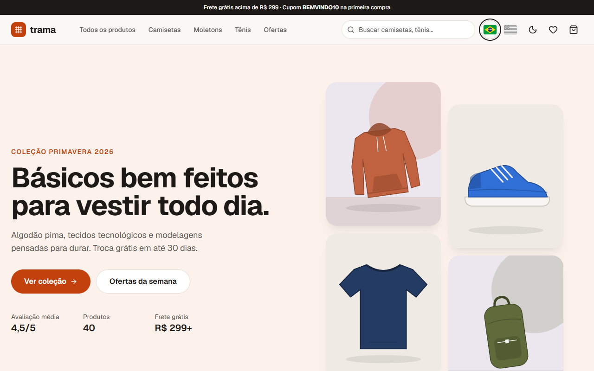

# Trama | e-commerce com Next.js

**Português** · [English](README.en.md)

Loja virtual de moda casual construída com **Next.js 16 (App Router)**, **React 19** e **TypeScript**, publicada como site 100% estático na Cloudflare. O projeto cobre o fluxo completo de uma loja: vitrine renderizada no build, catálogo com filtros sincronizados com a URL, páginas de produto geradas estaticamente com SEO e Open Graph, carrinho persistido, cálculo de frete por CEP, cupom de desconto, checkout em etapas com validação (Zod + React Hook Form), consulta de endereço no ViaCEP e confirmação de pedido com cartão, Pix ou boleto simulados. A interface e o catálogo estão disponíveis em **português e inglês**.

**Demo:** https://portfolio.brunoisaac.dev/next-ecommerce-store/ (redireciona para `/pt-BR/` ou `/en/` conforme o idioma do navegador)



> Projeto de portfólio: nenhum pagamento é processado e nenhum dado sai do navegador.
> Para testar o checkout use o CPF `529.982.247-25`, o cartão `4111 1111 1111 1111`, qualquer validade futura, CVV `123` e o cupom `BEMVINDO10`.

## Funcionalidades

- **Home** com hero, vantagens, categorias em destaque, mais vendidos e novidades, tudo em Server Components (sem JavaScript próprio no cliente).
- **Catálogo** com busca sem acentos, filtros por categoria, faixa de preço, cor, tamanho, avaliação e ofertas, além de ordenação. Os filtros ficam na URL (`/pt-BR/produtos/?categoria=tenis&cor=preto&ordem=menor-preco`), então dá para compartilhar o link, recarregar a página e usar o botão voltar.
- **Página de produto** para cada um dos 40 itens via `generateStaticParams`, com galeria (frente, detalhe e ambiente), seletor de cor que recolore as imagens, seletor de tamanho com validação, quantidade, favoritos e produtos relacionados.
- **SEO:** `generateMetadata` por produto, canonical, Open Graph e Twitter Cards com imagens PNG geradas no build, JSON-LD `Product` (preço e avaliação), `sitemap.xml` e `robots.txt` estáticos.
- **Carrinho** em gaveta lateral e em página própria: quantidade, remoção, subtotal, barra de progresso até o frete grátis, frete calculado por CEP (tabela regional simulada, econômica ou expressa) e cupom `BEMVINDO10` (10% off). O carrinho fica salvo no `localStorage` e sincroniza entre abas.
- **Checkout em 3 etapas:** dados pessoais (CPF validado pelos dígitos verificadores, máscaras de CPF e celular), entrega (CEP com preenchimento automático pelo ViaCEP e escolha do frete) e pagamento (cartão com Luhn, bandeira, validade e parcelas; Pix com 5% de desconto; boleto).
- **Confirmação do pedido** com número, resumo, endereço, código Pix copia e cola com QR Code ilustrativo ou linha digitável do boleto.
- **Favoritos** persistidos com contador no cabeçalho.
- **Dois idiomas (pt-BR e en)** com rotas `/pt-BR/...` e `/en/...`, seletor de idioma com bandeiras no cabeçalho, nomes e descrições dos produtos traduzidos, `hreflang` nos metadados e no sitemap.
- **Estados de interface:** `loading.tsx` com skeletons, `global-not-found.tsx` (vira o `404.html` bilíngue servido para URLs desconhecidas), `error.tsx`, estados vazios e de carregamento em cada tela.
- **Acessibilidade e UX:** HTML semântico, rótulos e mensagens de erro ligados aos campos (`aria-invalid`, `aria-describedby`), gaveta com `<dialog>` nativo (foco preso e Esc), link "pular para o conteúdo", foco visível, `prefers-reduced-motion`, layout mobile first e **tema escuro** sem flash na primeira pintura.

## Stack

| Camada      | Tecnologia                                                          |
| ----------- | ------------------------------------------------------------------- |
| Framework   | Next.js 16.3.5 (App Router, Turbopack, `output: "export"`)          |
| UI          | React 19.2.8, Tailwind CSS 4.3.3, lucide-react 1.47                 |
| Linguagem   | TypeScript 5.9 (strict)                                             |
| Estado      | Zustand 5.0.15 com `persist`                                        |
| Formulários | React Hook Form 7.88 + Zod 4.6 (`@hookform/resolvers` 5.9)          |
| Testes      | Vitest 5.0, Testing Library (React 16.3, user-event 14.6), jsdom 30 |
| Qualidade   | ESLint 9 (`eslint-config-next`), Prettier 3 com plugin do Tailwind  |
| CI/CD       | GitHub Actions (CI) + Cloudflare Workers static assets (deploy)     |
| API externa | [ViaCEP](https://viacep.com.br) (pública, sem chave)                |

## Arquitetura e decisões

- **Exportação estática para hospedagem estática.** `output: "export"`, `basePath: "/next-ecommerce-store"`, `trailingSlash: true` (cada rota vira `pasta/index.html`) e `images.unoptimized`. Sem servidor em produção não existem Server Actions, Route Handlers dinâmicos nem leitura de `searchParams` no servidor, e o projeto foi desenhado em torno disso:
  - o que é conteúdo (home, produtos, metadados, sitemap, imagens OG) é gerado no build;
  - o que depende do usuário (filtros, carrinho, checkout, pedido) roda no cliente;
  - a página de catálogo usa `useSearchParams` dentro de `Suspense`, cujo fallback já é uma grade real pré-renderizada, então o HTML exportado não chega vazio.
- **Imagens de produto em SVG gerado.** Cada categoria tem uma silhueta vetorial colorida pela paleta da variante. Não há dependência de banco de imagens nem requisições extras, a demo não quebra e a troca de cor é instantânea. As mesmas peças são renderizadas pelo Satori (`next/og`) para criar as imagens Open Graph em PNG.
- **Imagens OG via Route Handler `og.png`.** A convenção `opengraph-image` exporta arquivos sem extensão, que um host estático serviria como `application/octet-stream`. Route Handlers `force-static` em pastas `og.png` mantêm a extensão e o `Content-Type` correto.
- **Preços em centavos (inteiros)** para evitar erros de ponto flutuante. Toda a regra de negócio (frete, cupom, desconto Pix, parcelas, criação do pedido) fica em funções puras com testes.
- **Carrinho guarda só referências** (`productId`, cor, tamanho e quantidade). Nome e preço vêm sempre do catálogo, então um `localStorage` antigo nunca mostra preço desatualizado.
- **Hidratação segura dos stores persistidos.** Os stores Zustand usam `skipHydration` e são reidratados após a montagem. O HTML estático e a primeira renderização no cliente ficam idênticos, sem erros de hidratação, e `useSyncExternalStore` indica quando os dados locais já estão disponíveis.
- **Filtros na URL com `useOptimistic`.** `router.replace` roda dentro de uma transição; o estado otimista mantém checkboxes e radios responsivos enquanto a URL é atualizada.
- **Schemas Zod compostos de validadores puros** (CPF, Luhn, validade, CEP). Os validadores são testados isoladamente e reaproveitados nos schemas e nas máscaras de input.
- **Dados de pagamento nunca são persistidos.** O progresso do checkout vai para o `sessionStorage`; do cartão, o pedido guarda apenas bandeira e últimos 4 dígitos.
- **Organização por feature** (`features/catalog`, `cart`, `checkout`, `wishlist`, `seo`), com componentes de UI genéricos em `components/ui` e utilitários em `lib`.

### Como seria com SSR na Vercel

Com um servidor (Vercel ou `next start`), a mesma base evoluiria assim:

- remover `output: "export"`/`basePath` e ligar o otimizador de imagens (`next/image` com fotos reais de um CDN);
- ler `searchParams` no Server Component da página `/produtos` e filtrar no servidor (com `revalidate` ou cache por tag), mantendo a URL como fonte de verdade;
- buscar o catálogo de um CMS/banco com ISR (`revalidate`) e `revalidateTag` acionado por webhook ao alterar estoque ou preço;
- trocar o fluxo de pagamento simulado por Server Actions que validam o carrinho com os mesmos schemas Zod no servidor, recalculam preço e frete (sem confiar no cliente) e criam o pedido no banco;
- integrar frete real (Correios/transportadoras) e gateway de pagamento (Pix e cartão) em Route Handlers que recebem webhooks de confirmação;
- autenticação, histórico de pedidos e carrinho no servidor por usuário, usando cookies.

## Internacionalização

A loja tem **português do Brasil (padrão) e inglês**, sem bibliotecas extras: dicionários TypeScript tipados e o segmento de rota `[locale]`, que funciona com `output: "export"`.

- **Rotas:** `app/[locale]` gera com `generateStaticParams` uma árvore estática por idioma (`/pt-BR/...` e `/en/...`); `dynamicParams = false` deixa qualquer outro valor como 404. O layout de `[locale]` é o layout raiz dessa árvore, então o `<html lang>` sai correto já no HTML exportado.
- **Escolha do idioma:** como não há servidor para ler o `Accept-Language`, a página `/` (route group `(language-redirect)`) decide no navegador: escolha salva no `localStorage` > idioma do navegador (`pt*` → pt-BR, qualquer outro → en) > pt-BR, e redireciona. Há links de fallback para quem está sem JavaScript.
- **Seletor com bandeiras:** no cabeçalho (e no menu mobile), duas bandeiras em SVG inline são links reais `<a hreflang>` para a mesma página no outro idioma, com nome acessível no próprio idioma ("Português (Brasil)", "English"), `aria-current` no ativo e alvo de toque de 40px. O clique salva a escolha e preserva a query string (filtros e busca).
- **Dicionários:** `src/i18n/dictionaries/pt-BR.ts` é a fonte e define o tipo `Dictionary`; `en.ts` precisa ter exatamente as mesmas chaves ou o build falha. Textos com valores são funções (`found: (count) => ...`), o que dá plurais e interpolação tipados. Server Components chamam `getDictionary(locale)`; Client Components usam `useI18n()`, cujo provider recebe só o `locale`.
- **Conteúdo:** nomes, taglines, descrições e características dos 40 produtos estão em `features/catalog/data/products.en.ts`; categorias, cores e tamanhos (PP/P/M/G/GG → XS/S/M/L/XL) também são traduzidos. Mensagens de validação do Zod vêm do dicionário (os schemas são fábricas que recebem as mensagens).
- **Formatação:** números, datas e moeda usam `Intl` com o locale ativo; a moeda é sempre **BRL** (R$ 129,90 em pt-BR, R$129.90 em en).
- **SEO:** canonical e `alternates.languages` (`hreflang` + `x-default`) em cada página, `og:locale` por idioma, imagens Open Graph e JSON-LD por idioma, e `sitemap.xml` com as duas versões de cada URL.

**Como adicionar um idioma** (ex.: espanhol):

1. Inclua `"es"` em `locales` e nos mapas de `src/i18n/config.ts` (`intlLocale`, `ogLocale`, `localeNames`) e trate `es*` em `matchLocale` (`src/i18n/detect.ts`).
2. Crie `src/i18n/dictionaries/es.ts` tipado como `Dictionary` (o TypeScript aponta as chaves que faltam) e registre-o em `dictionaries/index.ts`.
3. Traduza o catálogo (`products.es.ts`, nomes de categorias e cores) e adicione a bandeira em `src/i18n/flags.tsx`.
4. Rode `npm test`: o teste de dicionários compara a estrutura de todos os idiomas.

## Como rodar

Pré-requisitos: Node.js 22 e npm 10.

```bash
npm install
npm run dev          # http://localhost:3000/next-ecommerce-store (abre /pt-BR/ ou /en/)
```

Outros scripts:

```bash
npm run lint         # ESLint
npm run typecheck    # gera os tipos de rotas e roda tsc --noEmit
npm test             # Vitest (unitários e de componentes)
npm run build        # exportação estática em ./out
npm run build:cf     # mesmo build de produção usado no deploy da Cloudflare
npm start            # serve ./out em http://localhost:3000/next-ecommerce-store
npm run format       # Prettier
```

> Observação: no Windows, o Next 16 exporta os arquivos de prefetch de segmentos com `\` no caminho, o que gera 404 inofensivos de prefetch no preview local. O build de deploy roda em Linux, onde os arquivos saem corretos.

## Deploy

Publicado na Cloudflare (Workers static assets) em https://portfolio.brunoisaac.dev/next-ecommerce-store/ pelo pipeline do repositório [portfolio](https://github.com/BrunoICosta/portfolio), que roda `npm run build:cf` e publica a pasta `out/` sob `/next-ecommerce-store/`. URLs desconhecidas recebem o `404.html` exportado pelo Next. O GitHub Actions deste repositório roda apenas a CI (lint, formatação, tipos, testes e build).

## Estrutura de pastas

```
src/
├── app/                      # rotas (App Router)
│   ├── (language-redirect)/  # "/" escolhe o idioma no navegador e redireciona
│   ├── [locale]/             # árvore por idioma (pt-BR, en), layout raiz com <html lang>
│   │   ├── page.tsx          # home (Server Component)
│   │   ├── produtos/         # catálogo com filtros
│   │   ├── produto/[slug]/   # página de produto + og.png gerado no build
│   │   ├── carrinho/  checkout/  favoritos/  pedido/confirmado/
│   │   ├── og.png/           # imagem Open Graph da loja
│   │   └── loading.tsx  not-found.tsx  error.tsx  layout.tsx
│   ├── global-not-found.tsx  # 404.html bilíngue
│   └── sitemap.ts  robots.ts
├── components/
│   ├── layout/               # cabeçalho, rodapé, menu mobile, tema
│   ├── providers/            # reidratação dos stores persistidos
│   └── ui/                   # botão, campos, sheet, preço, avaliação...
├── features/
│   ├── catalog/              # dados tipados, consultas, filtros, cards, arte SVG
│   ├── product/              # galeria e seletores de variante
│   ├── cart/                 # store, regras de preço/frete/cupom, gaveta e página
│   ├── checkout/             # schemas, validadores, ViaCEP, etapas, pedido
│   ├── wishlist/             # favoritos
│   ├── home/                 # seções da home
│   └── seo/                  # JSON-LD e cartão Open Graph
├── i18n/                     # idiomas, dicionários, provider, detecção, seletor com bandeiras
├── lib/                      # formatação, rotas, configuração do site, tema
└── test/                     # setup do Vitest
```

## Próximos passos

- Testes end-to-end com Playwright cobrindo compra completa e acessibilidade (axe).
- Avaliações de clientes por produto e filtros com contagem por opção.
- Estoque por variante (tamanho e cor esgotados).
- Histórico de pedidos com a lista já salva localmente.
- Segmentos de URL traduzidos (`/en/products/`) e slugs de produto por idioma.
- Versão SSR na Vercel com catálogo em CMS e pagamento real, conforme descrito acima.

## Autor

**Bruno Vinicius Isaac Costa** · https://github.com/BrunoICosta

Licença [MIT](LICENSE).
